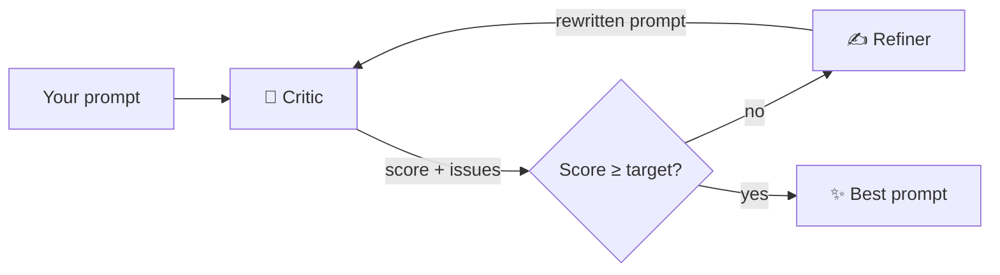

# 🎭 prompt-duet


> Two AI agents arguing about your prompt until it gets good.


## Why I built this

I was bored one night and wanted to mess around with agentic AI. I'd also gotten tired of pasting prompts into ChatGPT and typing "make this better," then getting something back with no idea *why* it was better.

So I built my own: one agent tears the prompt apart, another one fixes it, and they go back and forth until the critic is happy. All from my terminal, and I can see every round of the argument.

## How it works



- **Critic** scores the prompt 1–10 on clarity, specificity, context, output format, and constraints, and returns structured feedback (Pydantic + `with_structured_output`)
- **Refiner** rewrites the prompt based on that feedback, keeping the original intent and using `[placeholders]` instead of making stuff up
- They loop until the score hits the target or max rounds run out

## Things I learned building it

- **Later rounds can make it worse.** In testing I saw scores go 3 → 6 → 7 → 5, so the loop returns the *best-scoring* prompt, not the last one
- **The critic was punishing placeholders.** The Refiner added `[target audience]`-style slots, the Critic called them "missing info," and prompts got more bloated every round. Telling the Critic placeholders are fine (and that bloat is bad) fixed it
- **`rich` was eating my placeholders.** It treats `[anything]` as a style tag and silently deletes it, so the output looked broken even though it wasn't. `escape()` fixed it
- **Anchoring matters.** Both agents always see the original prompt so the rewrite doesn't drift into something else

## Try it

```bash
git clone https://github.com/<your-username>/prompt-duet.git
cd prompt-duet
python3 -m venv .venv && source .venv/bin/activate
pip install -r requirements.txt
cp .env.example .env   # paste your free Groq key from console.groq.com
```

```bash
python3 main.py "write me a blog post about AI"
python3 main.py --rounds 5 --target 8
```

Works with any LangChain-supported model. Change `MODEL` in `.env` (e.g. `openai:gpt-4o-mini`) and install that provider's package.

## What's next

- [ ] LangGraph version where the Critic decides when to stop (actual agent behavior)
- [ ] Fully local mode with Ollama
- [ ] Streamlit UI
- [ ] Save runs to JSON